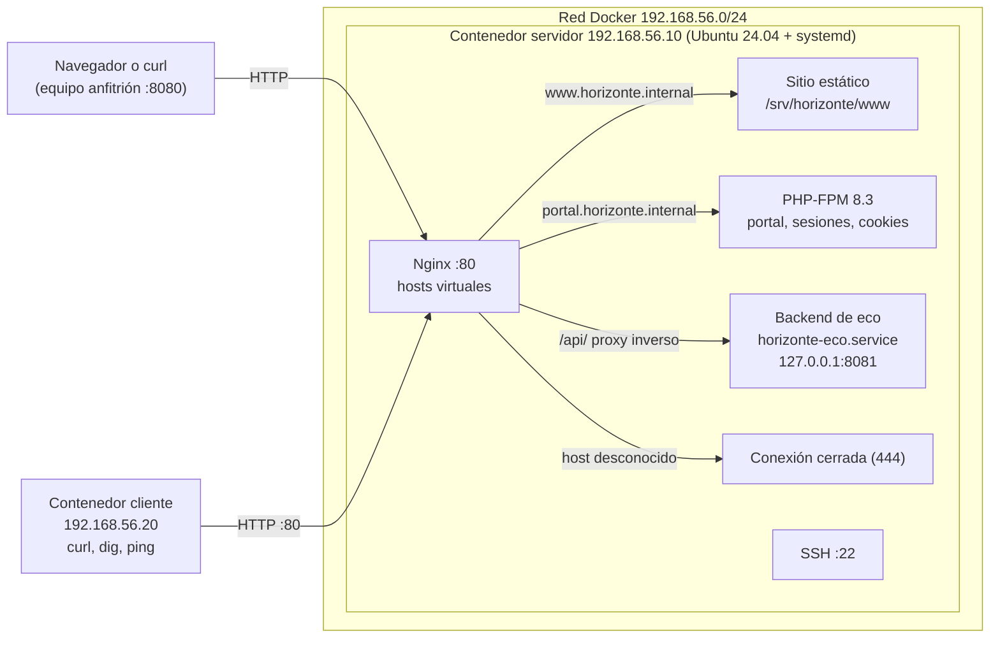

# Actividad 1 — Servidor web de la U.E. Horizonte

Proyecto del grupo Ubuntu de la materia Tecnología Web I (UPDS). Reúne el trabajo de los laboratorios 2, 3 y 4 en un entorno que se levanta con Docker: un servidor Ubuntu 24.04 con systemd, administrado con `systemctl`, que publica dos sitios con Nginx, un portal de padres en PHP-FPM con sesiones seguras y una API de eco detrás de un proxy inverso.

## Descripción

La Unidad Educativa Horizonte (institución ficticia del curso) necesita un servidor web propio. El proyecto incluye:

- **Laboratorio 2 – Administración del servidor:** nombre y zona horaria, paquetes base, usuario administrador `jhonc` con `sudo`, grupo `webadmin` con permisos `2775` para las carpetas del sitio, servicio SSH y red.
- **Laboratorio 3 – Nginx:** dos hosts virtuales (`www.horizonte.internal` y `portal.horizonte.internal`), página por defecto que rechaza nombres desconocidos, páginas de error propias, caché de estáticos y registros (logs) con el tiempo de respuesta.
- **Laboratorio 4 – Portal dinámico:** PHP-FPM, portal para padres con inicio de sesión, cookies y sesiones seguras (HttpOnly, SameSite) y proxy inverso hacia un backend de eco gestionado por systemd.

Todo se aplica con scripts repetibles (idempotentes) y se comprueba con tres verificadores automáticos.

## Arquitectura



El servidor y el cliente usan la misma imagen (`Dockerfile`). El repositorio se monta en el servidor en `/repo` (solo lectura) y los scripts copian de allí lo que instalan.

## Requisitos

- **Docker Engine** (Linux o WSL) o **Docker Desktop**, con **Docker Compose v2** (`docker compose`).
- Permiso para contenedores `privileged` y **cgroup v2** (el servidor ejecuta systemd; `cgroup: host`).
- Puerto **8080** libre en el equipo (se puede cambiar copiando `.env.example` a `.env` y editando `PUERTO_HTTP`).
- Subred `192.168.56.0/24` libre en Docker.
- Conexión a internet en el primer arranque (se descargan la imagen Ubuntu, Nginx y PHP).
- Git y Bash (en Windows: Git Bash o WSL).

## Inicio rápido

```bash
git clone https://github.com/TW1-GrupoUbuntu/Actividad_1.git
cd Actividad_1
docker compose up -d --build
bash scripts/levantar.sh
bash scripts/verificar_todo.sh
```

Resultado esperado de `verificar_todo.sh`:

```text
Laboratorio 2: Resultado: 14 de 14
Laboratorio 3: Resultado: 14 de 14
Laboratorio 4: Resultado: 16 de 16
TODO CORRECTO
```

Notas:

- Los scripts se ejecutan con `bash scripts/nombre.sh`; no hace falta darles permiso de ejecución. Si se prefiere, `chmod +x scripts/*.sh` y luego `./scripts/levantar.sh`.
- Para firmar la salida de los verificadores: `AUTOR="Nombre Apellido" bash scripts/verificar_todo.sh`.
- Los verificadores también se pueden ejecutar uno por uno dentro del servidor, por ejemplo: `docker compose exec servidor bash /repo/scripts/verificar_lab04.sh`.
- Todos los scripts son repetibles: se puede volver a ejecutar `bash scripts/levantar.sh` sin romper nada.
- Los archivos están en formato LF (`.gitattributes`). En Windows, si Git convierte los finales de línea, ejecutar `git config core.autocrlf input` antes de clonar.

## Pruebas rápidas con curl

Desde el contenedor cliente (los nombres ya resuelven al servidor):

```bash
docker compose exec cliente curl -i http://www.horizonte.internal/
docker compose exec cliente curl -i http://portal.horizonte.internal/
docker compose exec cliente curl -i http://www.horizonte.internal/no-existe        # 404 propio
docker compose exec cliente curl -I http://horizonte.internal/x                    # 301 hacia www
docker compose exec cliente curl http://portal.horizonte.internal/api/eco          # proxy inverso
docker compose exec cliente curl -i -H "Host: intruso.com" http://192.168.56.10/   # conexión cerrada (444)
```

Desde el equipo anfitrión, sin tocar el archivo de hosts, con `--resolve` o con la cabecera `Host`:

```bash
curl --resolve www.horizonte.internal:8080:127.0.0.1 http://www.horizonte.internal:8080/
curl --resolve portal.horizonte.internal:8080:127.0.0.1 http://portal.horizonte.internal:8080/
curl -H "Host: www.horizonte.internal" http://localhost:8080/circulares/
```

Para usar un navegador, agregar al archivo de hosts del equipo y abrir `http://www.horizonte.internal:8080/`:

```text
127.0.0.1  www.horizonte.internal horizonte.internal portal.horizonte.internal
```

- **Windows:** editar `C:\Windows\System32\drivers\etc\hosts` como administrador.
- **Linux y macOS:** `sudo nano /etc/hosts`.

Inicio de sesión del portal (datos de demostración): usuario `mamani.rosa`, clave `Horizonte2026`.

## Estructura del repositorio

| Ruta | Contenido |
| --- | --- |
| [`README.md`](README.md) | Esta documentación |
| [`docker-compose.yml`](docker-compose.yml) | Servidor y cliente en la red `192.168.56.0/24` |
| [`Dockerfile`](Dockerfile) | Imagen Ubuntu 24.04 con systemd |
| [`.env.example`](.env.example) | Variables opcionales (puerto) |
| [`scripts/`](scripts/) | Preparación, instaladores, verificadores y scripts de arranque |
| [`nginx/`](nginx/) | Hosts virtuales, sitio por defecto, formato de registros y proxy inverso |
| [`sitio/`](sitio/) | Sitio estático de `www` (inicio, 404, 50x, estilos, circulares) |
| [`portal/`](portal/) | Portal PHP: `public/` (visible) y `app/` (privado) |
| [`api/`](api/) | Backend de eco en Python (`servidor_eco.py`) |
| [`systemd/`](systemd/) | Unidad `horizonte-eco.service` |
| [`LICENSE`](LICENSE) | Licencia MIT |

Scripts principales:

| Script | Función |
| --- | --- |
| [`scripts/levantar.sh`](scripts/levantar.sh) | Aplica los laboratorios 2, 3 y 4 en el servidor |
| [`scripts/verificar_todo.sh`](scripts/verificar_todo.sh) | Ejecuta los tres verificadores y resume |
| [`scripts/preparar_servidor.sh`](scripts/preparar_servidor.sh) | Laboratorio 2 |
| [`scripts/instalar_sitios.sh`](scripts/instalar_sitios.sh) | Laboratorio 3 |
| [`scripts/instalar_portal.sh`](scripts/instalar_portal.sh) | Laboratorio 4 |
| [`scripts/verificar_lab02.sh`](scripts/verificar_lab02.sh), [`03`](scripts/verificar_lab03.sh), [`04`](scripts/verificar_lab04.sh) | Verificadores de cada laboratorio |
| [`scripts/preparar_entorno.sh`](scripts/preparar_entorno.sh) | Ajustes propios del contenedor (sudo sin clave del administrador) |

## Componentes

- **Usuarios y grupos:** el administrador `jhonc` pertenece a `sudo` y a `webadmin`. El grupo `webadmin` es dueño de `/srv/horizonte` con permisos `2775` (setgid), de modo que lo que crea el equipo queda siempre con ese grupo. El usuario `comunicacion` solo está en `webadmin`, sin `sudo`.
- **Paquetes:** `curl`, `htop`, `tree`, `ufw` y `unattended-upgrades` (con reinicio automático a las 03:00); luego `nginx` y `php8.3-fpm`.
- **Red:** red Docker `192.168.56.0/24` (puerta de enlace `.1`), servidor en `.10` y cliente de pruebas en `.20`.
- **systemctl:** SSH, Nginx, PHP-FPM y el backend de eco se administran como servicios (`systemctl status`, `enable --now`, `reload`, `journalctl -u`).
- **Nginx con dos hosts:** `www.horizonte.internal` (sitio institucional; `horizonte.internal` redirige con 301 a `www`) y `portal.horizonte.internal`. Las configuraciones están en [`nginx/`](nginx/) y se activan en `sites-enabled`; `nginx -t` se ejecuta antes de recargar.
- **Sitio por defecto:** cualquier nombre desconocido o acceso por IP recibe el código 444 (conexión cerrada), sin mostrar contenido.
- **Páginas de error propias:** `404.html` y `50x.html` del colegio; los archivos ocultos (`.env`, `.git`) devuelven 403.
- **Logs:** formato `horizonte` con el nombre del sitio y el tiempo de respuesta; un registro de acceso y de errores por sitio en `/var/log/nginx/`.
- **PHP-FPM:** Nginx pasa los `.php` a PHP-FPM 8.3 por un socket Unix; solo `portal/public/` es visible, `portal/app/` queda fuera de la web.
- **Proxy inverso:** la ruta `/api/` del portal se reenvía a `127.0.0.1:8081`, donde el servicio `horizonte-eco` (usuario `www-data`, reinicio automático, endurecido con `ProtectSystem` y `NoNewPrivileges`) devuelve en JSON lo que recibió, incluida la cabecera `X-Forwarded-For`. Si el backend cae, el portal muestra la página de mantenimiento en lugar de un error técnico.
- **Cookies y sesiones:** la cookie `HORIZONTESESSID` se emite con `HttpOnly` y `SameSite=Lax`; el identificador de sesión se regenera al iniciar sesión, los formularios llevan token CSRF, las claves se guardan con `password_hash` y cerrar sesión invalida la sesión.

## Solución de problemas

| Problema | Qué hacer |
| --- | --- |
| `bind: address already in use` | El puerto 8080 está ocupado. Copiar `.env.example` a `.env` y cambiar `PUERTO_HTTP`. |
| `Pool overlaps with other one` | Otra red de Docker usa `192.168.56.0/24`. Eliminarla o cambiar la subred en `docker-compose.yml` (y las IP `.10`/`.20`). |
| El servidor se detiene o systemd no arranca | Verificar cgroup v2 (`docker info \| grep -i cgroup`). En Docker Desktop, usar la versión reciente (WSL 2). |
| `levantar.sh` falla al instalar paquetes | Revisar la conexión a internet y repetir `bash scripts/levantar.sh` (es repetible). |
| `bad interpreter` o `\r` en los scripts | Los scripts quedaron con CRLF. Ejecutar `git config core.autocrlf input`, volver a clonar o `sed -i 's/\r$//' scripts/*.sh`. |
| Un verificador marca ❌ justo tras `levantar.sh` | Esperar unos segundos y repetir `bash scripts/verificar_todo.sh`. |
| `curl: Could not resolve host` desde el anfitrión | Usar `--resolve`, la cabecera `Host` o editar el archivo de hosts (ver pruebas con curl). |
| Ver el estado dentro del servidor | `docker compose exec servidor bash`, luego `systemctl status nginx php8.3-fpm horizonte-eco` y `journalctl -u horizonte-eco`. |

## Limpieza

```bash
docker compose down -v          # elimina contenedores, red y volumen
docker rmi horizonte-actividad1:24.04   # opcional: elimina la imagen
```

## Autores

Grupo Ubuntu, Tecnología Web I, Ingeniería de Sistemas, Universidad Privada Domingo Savio (UPDS), Santa Cruz, Bolivia.

- Sarai Alejandra Vidaurre
- Maria Lizeth Marcelo Carlos
- Camila Rebeca Mercado Duran
- Jhon Walter Choque Condori
- Ariel Davila
- David Julian Balencia Ayala

Docente: Ing. Jimmy Nataniel Requena Llorentty.

Licencia MIT (ver [`LICENSE`](LICENSE)).
